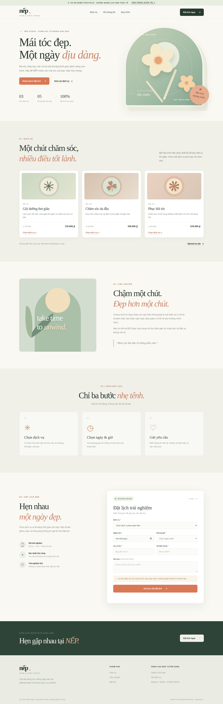
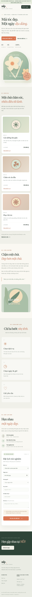
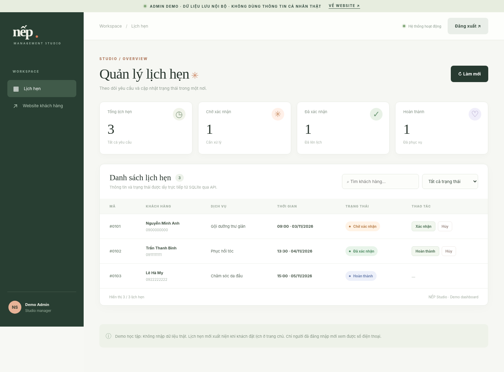

# NẾP studio — Full-stack Booking Demo

**Portfolio demo**: Website đặt lịch chăm sóc tóc có frontend, backend, API, cơ sở dữ liệu SQLite và trang quản trị. Thương hiệu NẾP studio là **hư cấu**. Không sử dụng để tiếp nhận lịch hẹn thật khi chưa có các bước hoàn thiện vận hành và bảo mật.

## Ảnh giới thiệu (portfolio)

**Giao diện trang khách hàng**



**Giao diện mobile**



**Dashboard quản trị**



*Ảnh chụp demo sử dụng dữ liệu minh họa; chưa được triển khai công khai.*

---

## Có những chức năng gì?

**Khách hàng (`/`):**
- Xem danh sách dịch vụ và giá từ API/database.
- Chọn dịch vụ, ngày, khung giờ còn trống; gửi yêu cầu đặt lịch.
- Xác thực thông tin đầu vào và báo lỗi rõ ràng.
- Không thể đặt trùng cùng một khung giờ còn hiệu lực.
- Giao diện responsive cho desktop và điện thoại.

**Quản trị (`/admin`):**
- Đăng nhập bằng mật khẩu quản trị; phiên đăng nhập lưu trong cookie `HttpOnly`, `SameSite=Strict`.
- Xem lịch hẹn và tổng quan trạng thái.
- Tìm theo tên, số điện thoại, mã lịch; lọc theo trạng thái.
- Xác nhận, hoàn thành hoặc hủy một lịch hẹn (theo chuyển trạng thái hợp lệ).
- Đăng xuất.

**Backend:** Node.js native HTTP, API JSON, SQLite bằng `node:sqlite`, không phụ thuộc package bên ngoài.


## Triển khai demo miễn phí

Xem [hướng dẫn Render Free](DEPLOY_RENDER.md) để chạy Node.js và nhận subdomain HTTPS miễn phí. **Lưu ý:** SQLite local trên Render Free không lưu dữ liệu bền vững; chỉ dùng với dữ liệu giả.


## Database bền vững trên Neon

Bản này hỗ trợ **SQLite local** và **Neon PostgreSQL trên Render** khi cấu hình `DATABASE_URL`. Xem [hướng dẫn cấu hình và kiểm thử dữ liệu](DEPLOY_NEON.md). Chỉ nên chuyển môi trường thật sau khi đã xác minh kết nối Neon và sao lưu dữ liệu cần giữ.

## Hosting Free không ngủ sau 15 phút

Có thể triển khai frontend + API lên **Cloudflare Workers Free** với Neon PostgreSQL hiện tại: [hướng dẫn Cloudflare](DEPLOY_CLOUDFLARE_FREE.md). Phiên bản Worker đang được phát triển trên nhánh `feature/cloudflare-workers-free`; Render cũ vẫn là môi trường hoạt động cho đến khi kiểm thử xong.

## Chạy trên máy cá nhân

**Yêu cầu:** Node.js **22.13+** (khuyên Node 22 LTS trở lên). `node:sqlite` có thể hiển thị cảnh báo API experimental ở một số phiên bản Node, nhưng bản demo đã được kiểm thử với Node 22.16.0.

```bash
# 1) Mở terminal tại thư mục dự án
npm run setup
# -> Sinh file .env và HIỂN THỊ mật khẩu quản trị một lần.

# 2) Chạy server
npm start

# 3) Mở trình duyệt
# http://localhost:3000
# http://localhost:3000/admin
```

**Windows:** sau khi giải nén và cài Node.js 22.13+, có thể nhấp đúp `CHAY_DEMO_WINDOWS.bat` để tạo cấu hình (lần đầu) và chạy server, hoặc mở PowerShell trong thư mục chứa `package.json` rồi chạy hai lệnh trên. Không cần `npm install` do demo dùng hoàn toàn API tích hợp của Node.js.

- Nếu port 3000 đã dùng, chỉnh `PORT` trong file `.env`.
- File database được tạo ở `data/bookings.sqlite` khi server khởi động.
- File `.env` và database đã có trong `.gitignore`; **không** commit hoặc gửi lên GitHub.
- Mật khẩu do `npm run setup` tạo ra chỉ hiển thị tại thời điểm thiết lập; hãy lưu trong trình quản lý mật khẩu. Nếu quên, dừng server, thay `ADMIN_PASSWORD` trong `.env` bằng một mật khẩu dài khó đoán; giữ nguyên `SESSION_SECRET` nếu muốn giữ phiên cũ hoặc thay secret để đăng xuất tất cả phiên.

## Chạy kiểm thử tự động

```bash
npm test
```

Kiểm thử tích hợp sẽ tự tạo database tạm, chạy server trên cổng ngẫu nhiên rồi kiểm tra API, quyền truy cập, chống trùng lịch và cập nhật trạng thái; không tác động dữ liệu demo chính.

## API

| Method | Route | Chức năng | Cần đăng nhập |
|---|---|---|---|
| GET | `/api/services` | Danh sách dịch vụ | Không |
| GET | `/api/availability?date=YYYY-MM-DD` | Khung giờ còn trống | Không |
| POST | `/api/bookings` | Đặt lịch mới | Không |
| POST | `/api/admin/login` | Đăng nhập | Không |
| GET | `/api/admin/me` | Kiểm tra phiên | Không |
| POST | `/api/admin/logout` | Đăng xuất | Không |
| GET | `/api/admin/bookings` | Danh sách lịch hẹn | Có |
| PATCH | `/api/admin/bookings/:id` | Cập nhật trạng thái | Có |

Ví dụ tạo lịch hẹn:

```json
{
  "serviceId": "goi-duong",
  "name": "Nguyen Van A",
  "phone": "0900000000",
  "date": "<YYYY-MM-DD, trong 60 ngày tới>",
  "time": "09:00",
  "note": "Đặt lịch thử nghiệm"
}
```

Các khung giờ: `09:00`, `10:30`, `13:30`, `15:00`, `16:30` (giờ Việt Nam). Có thể sửa trong `src/db.mjs` và UI sẽ lấy danh sách từ API.

## Cấu trúc thư mục

```text
fullstack-booking-demo/
├── public/
│   ├── index.html          # Frontend khách hàng
│   ├── admin.html          # Giao diện quản trị
│   ├── styles.css          # Responsive UI
│   ├── app.js              # Frontend đặt lịch, gọi API
│   ├── admin.js            # Frontend quản trị, gọi API
│   └── favicon.svg
├── src/
│   ├── db.mjs              # SQLite schema và truy vấn
│   └── security.mjs        # Cookie session, login rate limit
├── scripts/setup.mjs      # Sinh .env an toàn
├── tests/api.test.mjs     # Integration tests
├── server.mjs             # HTTP server, route, validation
├── CHECKLIST_KY_THUAT.md  # Checklist để tự nghiệm thu
├── .env.example
└── package.json
```

## Phạm vi của bản demo / lưu ý an toàn

Đây là **MVP chạy local** để trình bày năng lực full-stack, chưa phải hệ thống sẵn sàng bán cho khách hàng thật. Để triển khai production, cần ít nhất:

1. Hosting có HTTPS, backup/khôi phục dữ liệu, monitoring và quy trình cập nhật.
2. Chính sách dữ liệu cá nhân, biểu mẫu đồng ý phù hợp và quy trình xử lý/xóa dữ liệu nếu lưu thông tin khách thật.
3. Cải thiện quản trị: tài khoản riêng cho nhân viên, phân quyền, đặt lại mật khẩu, giới hạn tần suất API và audit log.
4. Kiểm thử thêm tình huống biên: concurrency, độ ổn định phiên, Unicode/input, tình huống lệch múi giờ, lỗi mạng.
5. Cấu hình host, reverse proxy, cookie `Secure` trong production; xác thực `Origin`/CSRF phù hợp môi trường thực tế.
6. Điều chỉnh logic đặt lịch dựa trên thời lượng dịch vụ, nhân viên, ngày nghỉ và năng lực vận hành của khách hàng. **Bản demo chỉ cho phép một booking/khung giờ toàn studio**.
7. Rà soát bảo mật độc lập trước khi xử lý dữ liệu thật hoặc đưa lên Internet. Không nhập tên/số điện thoại thật để thử nghiệm.

## Gợi ý cách đưa vào portfolio

**Tên:** Website đặt lịch dịch vụ + Dashboard quản trị (Full-stack demo)

**Vai trò:** Phân tích yêu cầu, triển khai giao diện và API với hỗ trợ AI; kiểm thử luồng đặt lịch, xác thực, database và bàn giao.

**Công nghệ:** HTML/CSS/JavaScript, Node.js, SQLite, REST API.

**Điểm nổi bật để trình bày:** Một lịch hẹn được ghi vào SQLite; quản trị có thể thấy và đổi trạng thái; hai khách không thể đặt trùng cùng giờ; API quản trị yêu cầu xác thực.

**Quan trọng:** Chỉ ghi những gì bạn thật sự hiểu, đã kiểm tra và có thể giải thích. Việc sử dụng AI khi xây dựng là bình thường, nhưng nên mô tả trung thực.
